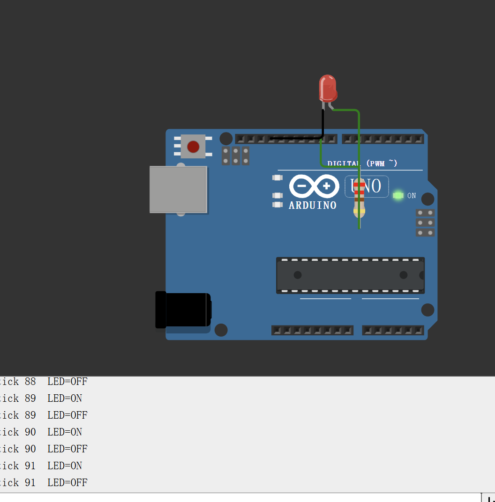

# Wokwi 第一个仿真：点灯 + 串口打印

P0 的第二个节点。目标不是写出多复杂的代码，而是第一次把「代码 → 引脚电平 → 灯亮 → 串口输出」这条链路完整跑通，并且建立一个可复现的仿真工程。

## 实现内容

- 每 500 ms 翻转一次 GPIO9 的电平，外接 LED 随之亮灭。
- 同步向串口打印计数，格式 `tick N  LED=ON` / `tick N  LED=OFF`。
- 全程在 Wokwi 在线仿真里完成，不需要任何硬件。

## 运行结果



串口连续跑到 tick 91，`LED=ON` / `LED=OFF` 与板上红灯同步交替。

## 电路

| 起点 | 经过 | 终点 |
|---|---|---|
| Arduino Uno `D9` | 220 Ω 电阻 | LED 正极（长脚 / A） |
| LED 负极（短脚 / C） | — | Arduino Uno `GND` |

`diagram.json` 就是这份接线，直接粘贴到 Wokwi 的 Diagram 编辑器即可，不用手动拖线。

## 代码

见 `sketch.ino`。核心只有三件事：

```cpp
pinMode(9, OUTPUT);                       // 把 D9 配成输出
digitalWrite(9, HIGH); / LOW;             // 置高 / 置低
Serial.begin(115200); Serial.println(...); // 串口 115200
```

## 运行步骤

1. 打开 <https://wokwi.com/projects/new/arduino-uno>，新建 Arduino Uno 工程。
2. 切到 **Code** 标签，点 `sketch.ino`，**先全选删除模板代码**，再粘贴本目录的 `sketch.ino`。
3. 点 `diagram.json` 标签，全选删除，粘贴本目录的 `diagram.json`。
4. 切回 **Simulation**，点绿色 ▶ 开始仿真。
5. 底部串口监视器（默认 115200）应持续输出 `tick N LED=ON/OFF`，同时板上 D9 外接的红色 LED 每秒亮灭一次。

## 验收标准

- 串口连续打印计数，N 递增不跳号。
- LED 与串口打印的 ON/OFF 同步。
- 连续运行 1 分钟不报错。

## 踩坑记录

1. **`redefinition of 'void setup()'`**
   新建工程自带的模板里已经有 `setup()` / `loop()`。直接粘贴会在文件末尾多出一份定义，编译报重复定义。必须先全选删除模板，再粘贴。

2. **看不到灯闪**
   Arduino Uno 的板载 `L` 灯在 Wokwi 里图形很小、亮灭几乎看不出来。用外接 LED（本目录 `diagram.json`）才有一眼可见的效果，也顺便练了限流电阻的接法。

3. **点 Run 后显示 `#5 in the build queue`**
   未登录用户要排队等 Wokwi 的编译服务器，不是卡死。等一两分钟即可，中途不要关页面。

4. **LED 常亮或完全不亮**
   常亮通常是接到了 5V/3V3 而不是 GPIO；完全不亮多半是正负极接反（长脚接电阻、短脚接 GND）。改代码里的引脚号再试：如果换引脚后灯不再常亮，说明原来的引脚接错了。

5. **串口没有输出**
   先确认代码里 `Serial.begin(115200)` 和监视器波特率一致，再看是否真的点了 Run（暂停状态下不刷新）。
